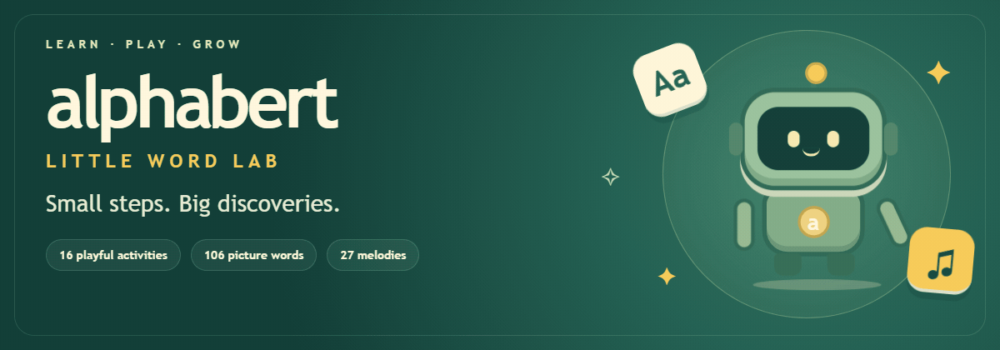
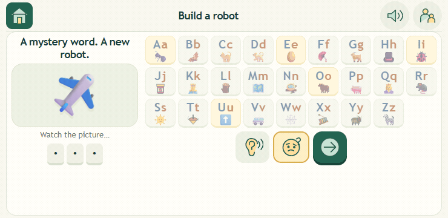
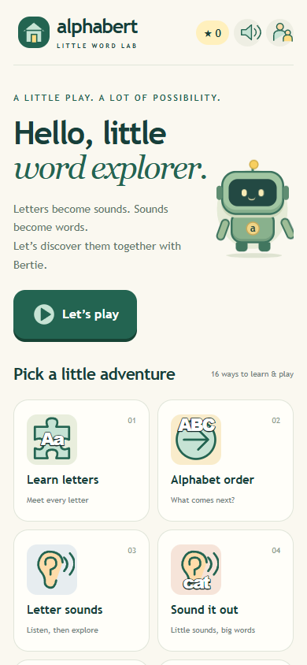
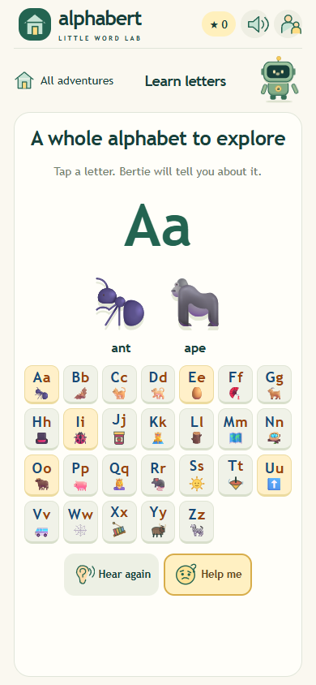
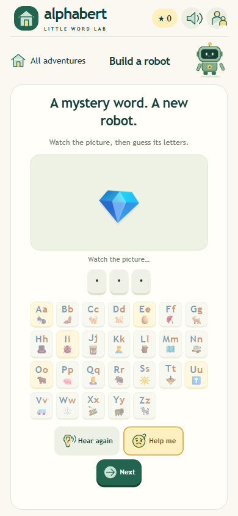
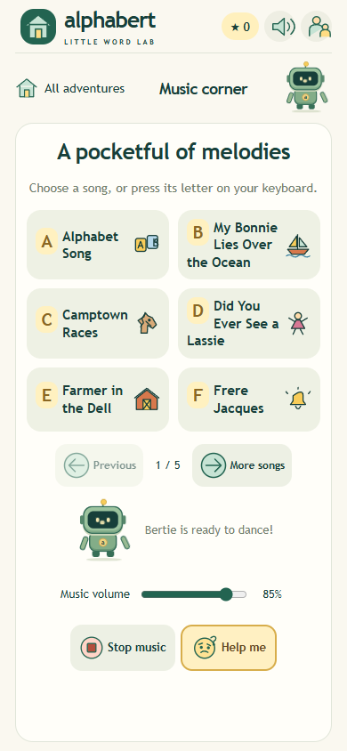

# Alphabert · Little Word Lab

**A talking robot friend for little learners.**

Meet Bertie! Explore letters, listen to sounds, build words, solve picture puzzles, count objects, and enjoy familiar tunes. Alphabert brings **16 playful activities** together in an Android game designed with preschoolers in mind.

**106 built-in words · 27 melodies · Offline play · Add your own words**

## A little robot magic

| Meet Bertie | Watch a picture clue |
| --- | --- |
|  |  |

*These looping previews use the game's artwork and animations. Prefer still images? [View the banner](docs/images/banner.png), [Bertie](docs/images/bertie-dance.png), or [picture clue](docs/images/animated-clue.png).*

## Take a look

| Pick an adventure | Meet the letters |
| --- | --- |
|  |  |

| Solve a picture mystery | Make time for music |
| --- | --- |
|  |  |

*Screenshots from the phone-sized browser preview. Artwork and emoji appearance can vary between devices.*

## What can children do?

- **Explore letters and sounds.** Meet uppercase and lowercase letters, tap pictures, and hear the sounds inside words.
- **Play with words.** Find missing letters and vowels, unscramble words, match rhymes, spot blends, and search for hidden words.
- **Think and remember.** Find the picture that does not belong, follow a growing memory trail, and solve a mystery word while building a robot.
- **Practice counting.** Count pictures, tap them silently to keep track, and choose the matching number.
- **Enjoy music.** Pick from 27 familiar melodies, with pictures to help children find a favorite.

## A little help along the way

Bertie talks through the activities, offers hints, celebrates with happy tunes and colorful effects, and has jokes and animated reactions to discover. Tap him to see what he does next!

Picture buttons and illustrated letter keys help children find their way before they can read. **Help me** offers a clue before stronger help. **Hear again** repeats the instruction or clue, and **Let's play** picks an activity to try.

The games work in portrait or landscape, with each activity fitting on the screen. Children can take their time, repeat a sound, and explore at their own pace.

## Download and install on Android

**APK download: not linked yet.** This repository provides the source code. To create an installable APK, follow the [Android build instructions](android/README.md).

Once you have the APK:

1. Open it from **Downloads** on an Android phone or tablet running **Android 8 or later**.
2. If Android asks, allow the app you opened the file with to install it, then tap **Install**.
3. Open Alphabert and choose an adventure!

## Ready for offline play

The built-in voices, pictures, games, and melodies are included with the app. **No login or internet connection is needed to play.** The Android app does not request internet, microphone, or storage permissions.

Progress and words you add stay on the device. Grown-up settings include speech, music and answer-sound controls, plus a reduced-motion option.

## Make it your child's word collection

Open **Grown-ups → Add a word** to add familiar words and a picture emoji. You can also import or export a word pack to share additions or keep a backup.

New words without a bundled recording use the device's voice; an installed offline English voice helps keep them available without internet. Export your additions before uninstalling the game or clearing its data.

## Want to work on the game?

The game is built with **JavaScript, HTML and CSS**, with a **Java Android wrapper**. Words and lessons are editable JSON files.

- [Developer setup and project guide](CONTRIBUTING.md)
- [Adding words and lessons](content/README.md)
- [Android build instructions](android/README.md)
- [Voice and audio workflow](scripts/SPEECH.md)
- [Putting the source on GitHub](GITHUB.md)

For a browser preview, install Node.js, run `npm start` from the project folder, and open `http://127.0.0.1:4173`.
